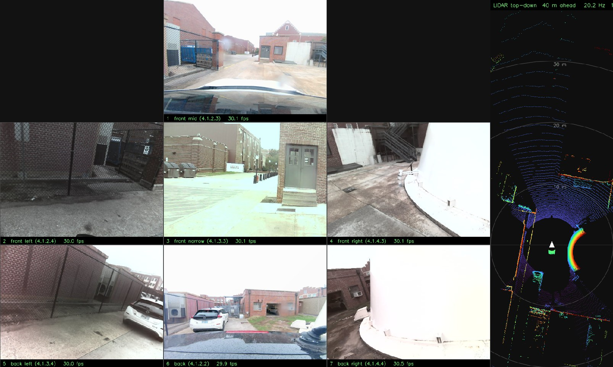

# Seven USB cameras + Ouster LiDAR, live on Jetson AGX Thor

Live viewers for a multi-camera rig on a Jetson AGX Thor (Jetson Linux 38.2.x,
kernel 6.8.12-tegra):

- `cameras.py`: every connected UVC camera in one window, laid out as seen
  from above the car, with live fps per camera.
- `cameras_lidar.py`: the same camera grid with a live top-down view of an
  Ouster OS1-128 LiDAR beside it, and recording of all cameras, LiDAR scans
  and the LiDAR's IMU.

With the patched `uvcvideo` driver in [`uvcvideo_mjpeg_patch/`](uvcvideo_mjpeg_patch/),
all seven cameras stream MJPEG **640x480 at 30 fps each** on one USB 2.0 link.

## Demo

[](https://drive.google.com/file/d/1XaF5WDu_NID75tldc3q3ohd11IRpWh4t/view?usp=drive_link)

[Watch the demo video](https://drive.google.com/file/d/1XaF5WDu_NID75tldc3q3ohd11IRpWh4t/view?usp=drive_link)
(Google Drive): all seven cameras and the live LiDAR top-down view.

## Cameras

Cameras are identified by USB port (from `/dev/v4l/by-path/`), because
`/dev/videoN` numbers change between boots. Several cameras of one model also
report the same serial number, so the port is the only reliable identity.

| Port | Role | Camera | USB ID |
|---|---|---|---|
| 4.1.2.3 | front mid (wide) | Global Shutter (AR0234) | 32e4:0234 |
| 4.1.2.4 | front left | 16MP USB Camera | 32e4:0298 |
| 4.1.3.3 | front narrow | HD USB Camera | 32e4:8830 |
| 4.1.4.3 | front right | 16MP USB Camera | 32e4:0298 |
| 4.1.3.4 | back left | 16MP USB Camera | 32e4:1298 |
| 4.1.2.2 | back | Global Shutter (AR0234) | 32e4:0234 |
| 4.1.4.4 | back right | 16MP USB Camera | 32e4:0298 |

Layout as of 2026-10-31. If a camera moves to another USB port, update
`CAMERA_ORDER`, `GRID`, `MIRRORED` and `OVERRIDES` in `cameras.py`.

All cameras hang off one hub chain on the Thor's USB 2.0 root port `1-4`
(480 Mbit/s shared), together with the Xsens MTi-30 IMU and the Septentrio GPS.
They are USB 2.0 devices, so a USB 3 port adds no bandwidth.

Use a hub with its own power supply and a firm cable to the Thor. The hub has
dropped off the bus several times, taking every camera, the IMU and the GPS
with it at once (kernel log: a burst of `USB disconnect` for `1-4.1.*`, or
`unable to enumerate USB device`). It comes back within seconds, but the
viewer exits (see Troubleshooting).

## Quick start

```bash
python3 -m venv camvenv
camvenv/bin/pip install -r requirements.txt
sudo apt install v4l-utils          # v4l2-ctl, used for frame rate and exposure
```

Live view of every camera (the window opens on the Thor's display):

```bash
DISPLAY=:1 camvenv/bin/python cameras.py
```

The default mode is MJPG 640x480 @30. Any `FOURCC WIDTH HEIGHT FPS` can be
passed on the command line, e.g. `cameras.py MJPG 1280 720 30`.

Keys: `1`-`9` show one camera large (numbered in reading order of the grid),
`0` returns to the grid, `o` switches indoor/outdoor exposure, `f` toggles full
screen, `q` quits.

### Layout

`GRID` in `cameras.py` places each camera by port, row by row; `None` leaves a
slot empty. The current layout:

| | Left | Middle | Right |
|---|---|---|---|
| Row 1 | | front mid (wide) | |
| Row 2, front | front left | front narrow | front right |
| Row 3, back | back left | back | back right |

The back row is mirrored left-right (`MIRRORED`), like a rear-view mirror, so
the car's left side is on the left of the screen in every row. Mirroring is
display-only. Connected cameras missing from `GRID` appear on an extra row.

## Cameras + LiDAR

`cameras_lidar.py` adds a top-down view of the Ouster point cloud: 40 m ahead,
20 m behind and 10 m to each side, distance rings every 10 m, points coloured
by height. The LiDAR is mounted facing backwards, so its points are turned
180 degrees (`LIDAR_YAW_DEG`) to put the car's front at the top.

It needs ROS 2 Jazzy (`rclpy`), so it runs with the system Python, in the same
ROS environment as the LiDAR driver. Start the Ouster driver first (in its own
terminal), then the viewer:

```bash
source /opt/ros/jazzy/setup.bash
export ROS_DOMAIN_ID=1 RMW_IMPLEMENTATION=rmw_cyclonedds_cpp ROS_AUTOMATIC_DISCOVERY_RANGE=SUBNET
DISPLAY=:1 /usr/bin/python3 cameras_lidar.py              # indoors
DISPLAY=:1 /usr/bin/python3 cameras_lidar.py --outdoor    # daylight
```

Options: `--outdoor` starts with auto exposure (see Exposure below),
`--record` starts recording at launch. Keys: `r` starts/stops recording, `o`
switches indoor/outdoor exposure, `f` toggles full screen, `q` quits (and
finishes any recording).

### Recording

Press `r` in the window to start and stop recording, or launch with
`--record`. A red `REC` bar shows elapsed time, counts, dropped items and the
write queue; it adds `LIDAR STALLED` if no LiDAR scan arrives for over a
second. Each recording is one folder, `recordings/YYYYMMDD_HHMMSS/`:

| Path | Contents |
|---|---|
| `meta.json` | Ports, roles, capture modes, LiDAR mounting (`yaw_to_car_deg`) |
| `cameras/<role>/NNNNNN.jpg` | Every frame from each camera, as captured (not mirrored) |
| `cameras.csv` | Camera, port, index, wall-clock and monotonic time (ns), file |
| `lidar/NNNNNN.npz` | Each scan: `xyz` (float32, metres, LiDAR frame) and `intensity` (uint16) |
| `lidar.csv` | Index, ROS stamp, wall-clock and monotonic time (ns), point count, file |
| `lidar_imu.csv` | Ouster IMU at 100 Hz: acceleration and angular rate (LiDAR frame) |
| `log.txt` | Start/stop, lighting switches, LiDAR stalls and any errors |

Measured on the rig: all seven cameras at 30 fps, LiDAR at 20 Hz, nothing
dropped. Size depends on the scene: **19-47 MB/s (about 1.1-2.8 GB per
minute)**. Recording refuses to start, and stops itself, below 5 GB of free
disk.

- Files are written by background threads, so the display never waits for
  the disk; if the disk falls behind, new items are dropped and counted.
- The CSV indexes are written line by line, so a crash keeps everything
  recorded up to that moment.
- An error in the LiDAR or IMU callback is logged and survived instead of
  silently stopping LiDAR data.
- LiDAR data stays in the LiDAR's frame: rotate by `LIDAR_YAW_DEG` (180) to
  get the car frame (x forward, y left).
- GPS and the Xsens IMU are not recorded yet.
- `recordings/` is ignored by git.

The LiDAR driver is the Ouster ROS 2 driver (`ouster_ros`, started with the
rig's `start_ouster.sh`), publishing `/points` at 20 Hz in mode `1024x20` and
`/imu` at 100 Hz. A terminal without the exports above uses
ROS domain 0 and does not see the LiDAR topics. Converting about 130,000
points per frame takes roughly two CPU cores.

## Exposure and frame rate

Auto exposure keeps the shutter open longer than a 30 fps frame allows in dim
light, so cameras drop to 10-20 fps (the 16MP models to 10). Adding gain does
not shorten it. The viewer therefore uses a fixed exposure:

| Setting | Value |
|---|---|
| Shutter (`EXPOSURE`) | 30 ms (`300`, units of 0.1 ms); must stay under 33 ms for 30 fps |
| Gain, 16MP cameras | 80 (smaller pixels, darker at the same shutter) |
| Gain, Global Shutter and HD USB | 0 |
| Anti-flicker (`POWER_LINE_HZ`) | 60 Hz (the cameras default to 50) |

A fixed exposure does not adapt to light: tuned for a dim garage, it washes
out views facing daylight. Both viewers therefore have two lighting presets:

| Preset | Exposure | Use |
|---|---|---|
| `indoor` (default) | Fixed 30 ms shutter, per-camera gain | Dim garage: holds 30 fps |
| `outdoor` | Each camera's auto exposure, gain 0 | Daylight: short shutters, 30 fps |

Press `o` in the window to switch live, or launch with `--outdoor`. Per-camera
indoor values go in `OVERRIDES`.

Also:

- `BUFFERS = 4` driver buffers per camera. With 1 buffer the cameras drop
  every other frame (20 fps becomes 10).
- The viewer sets the frame rate on the device with `v4l2-ctl` and prints the
  rate the device actually accepted, since some cameras ignore OpenCV's
  request.
- Settings live in the program, not the camera: an unplugged camera returns
  to auto exposure and 50 Hz until the viewer opens it again.

## What limits many cameras, and the fix

In MJPEG the Global Shutter cameras ask for the largest USB 2.0 isochronous
slot (3 x 1020 bytes per microframe, about 24 MB/s) at every resolution. Only
two fit on the shared link, so the rest show `NO FRAMES`, and the kernel log
says:

```
usb 1-4.1.4.3: Not enough bandwidth for altsetting 11
```

The stock bandwidth quirk (`quirks=128` in `/etc/modprobe.d/uvcvideo.conf`)
only applies to uncompressed formats. The patched driver adds a
`mjpeg_payload` parameter that caps the MJPEG request; with
`mjpeg_payload=800` each camera reserves about 6.4 MB/s. Seven cameras at
640x480 @30 reserve 44.8 MB/s of the roughly 60 MB/s available.

Uncompressed YUYV does not scale: at 640x480 it needs about 18 MB/s per
camera, two fit, and a third stops all of them (`Failed to resubmit video URB`).

Build, install and undo steps: [`uvcvideo_mjpeg_patch/README.md`](uvcvideo_mjpeg_patch/README.md).
Check that the patched driver is active:

```bash
cat /sys/module/uvcvideo/parameters/mjpeg_payload     # 800; missing = stock driver
```

## Troubleshooting

- **A tile says `NO FRAMES`:** run
  `grep "Not enough bandwidth" /var/log/kern.log | tail`. If it lists that
  camera, the patched driver is not loaded (see the check above), or the
  chosen mode needs more than the link has.
- **Every camera disappears at once** (`No such device` for every camera, then
  `terminate called without an active exception`): the USB hub dropped off
  the bus, and OpenCV aborts the viewer. Check the hub's power supply and its
  cable to the Thor, wait for the cameras to return (`v4l2-ctl --list-devices`),
  and start the viewer again. A recording keeps everything written before
  the crash.
- **`LIDAR STALLED` while recording:** the LiDAR driver stopped publishing, or
  the viewer stopped receiving. The cause is in the terminal and in the
  recording's `log.txt`.
- **The LiDAR panel says `NO DATA`:** the driver is not running, or this
  terminal is not in its ROS environment (see the exports above).
- **The driver cannot be swapped (`Module uvcvideo is in use`):** close every
  program using a camera. `fuser -v /dev/video*` shows which one.
- **After a JetPack or kernel update:** the patched module lives in the old
  kernel's `updates/` folder, so the stock driver comes back. Rebuild it
  against the new kernel as described in the patch README.

## Files

| Path | Contents |
|---|---|
| `cameras.py` | Live viewer for every connected camera |
| `cameras_lidar.py` | Camera grid plus live LiDAR top-down view and recording (ROS 2) |
| `requirements.txt` | Python packages for `cameras.py` |
| `uvcvideo_mjpeg_patch/` | Driver patch, NVIDIA's original source, patched source, `check_all_cameras.py` |
| `camtest.txt`, `hdcam.txt` | `v4l2-ctl` format and control dumps of two camera models |
| `media/preview.jpg` | Screenshot of the cameras and LiDAR view |
| `cameras_working.py` | Earlier version of the viewer, kept for reference |
